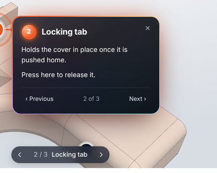
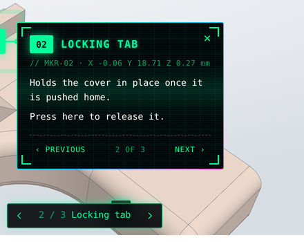
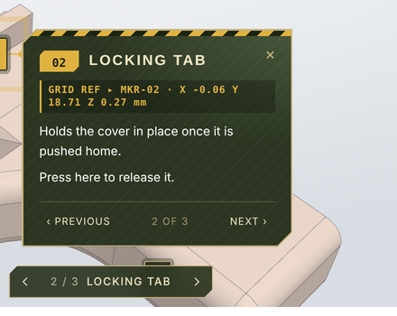
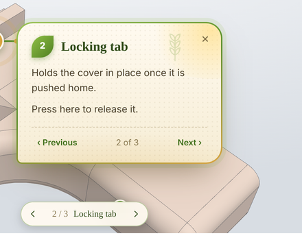

# STEP Viewer

## Try the demo

**Live demo: https://afkiwers.github.io/model-3D-viewer/**

`index.html` shows two viewers using `models/Connector.stp`. It is published to GitHub Pages by
`.github/workflows/pages.yml` each time a release is published (or when the workflow is run by hand
from the Actions tab), so the live demo always shows the latest release. To run it locally instead
(browsers won't load files from `file://`), serve the folder:

```sh
python3 -m http.server 8000
# then open http://localhost:8000
```

## What it does

A drop-in 3D viewer for STEP files on your website. Plain JavaScript in one file, no build step,
no framework. Point it at a `.step` / `.stp` file on your server and visitors get:

* **Orbit, pan and zoom** with mouse, trackpad or touch. Zoom goes towards the cursor, and a
  double-click makes that point the new centre of rotation.
* **A view cube** in the corner: click a face, edge or corner to look from there (26 views), drag the cube
  to turn the model, drag the compass ring to spin it, and roll it in 90° steps.
* **A ruler** that snaps to corners and edges and shows the distance plus ΔX / ΔY / ΔZ.
* **Markers**: numbered hotspots that open an animated card with a title and description.
  The camera flies to each one.
* **Standard views** (isometric, front, top, ...), reset, fullscreen and an optional download button.
* The colours from the file, CAD-style edge lines, and the model's overall size.

The STEP file is read in the browser by [occt-import-js](https://github.com/kovacsv/occt-import-js)
(OpenCascade compiled to WebAssembly) and drawn with [three.js](https://threejs.org). Both load from
the jsDelivr CDN by default. IGES (`.igs`, `.iges`) and BREP files work too.

## Quick start

```html
<div class="step-viewer" data-src="/models/part.step"></div>

<script src="/js/step-viewer.js"></script>
```

That's it. Every element with `class="step-viewer"` and a `data-src` is turned into a viewer when
the page loads. The model only starts loading once it is scrolled into view.

The file must be served from your own site (or from a server that allows cross-origin requests).

### Using it in Wiki.js or another CMS

Use **full paths** (starting with `/` or `https://`) for the script and the model. A relative path such as
`js/step-viewer.js` is looked up next to the current page, so on a wiki page like `/en/docs/drawings` the
browser asks for `/en/docs/drawings/js/step-viewer.js`. The wiki answers with a "page not found" page, and the
browser refuses to run it (*"MIME type ('text/plain') is not executable"*).

You don't have to host the script yourself: jsDelivr serves it from this repository's releases.

```html
<script src="https://cdn.jsdelivr.net/gh/afkiwers/model-3D-viewer@0.0.6/step-viewer.js"></script>

<div class="step-viewer" data-src="/files/drawings/bracket.step"></div>
```

In **Wiki.js**, the cleanest place for the script tag is *Administration → Theme → Head HTML Injection*, so
every page can use viewers. Upload the model as an asset and use the path Wiki.js gives it, starting with `/`.
Viewers also work when the page content is rendered by JavaScript after loading, as Wiki.js and other
single-page apps do.

## Options

Set options as `data-*` attributes on the element, or pass them to `StepViewer.create()`.
In HTML, `downloadName` becomes `data-download-name` and so on.

| Option | Default | What it does |
| --- | --- | --- |
| `src` | *(required)* | URL of the STEP file. In JavaScript it can also be a `File` (from a file picker or drag and drop), which is read locally. |
| `width` | `100%` | Viewer width. Any CSS length; plain numbers are pixels. |
| `height` | `480px` | Viewer height. Any CSS length; plain numbers are pixels. |
| `zoom` | `1` | Starting zoom. `1` fits the model to the view, `2` is twice as close, `0.5` twice as far. |
| `view` | `iso` | Starting view: `iso`, `front`, `back`, `left`, `right`, `top`, `bottom`, or a camera direction such as `"1,-2,1"`. |
| `rotation` | `0,0,0` | Rotation of the model, in degrees about X, Y and Z, for files that arrive lying on their side. The demo's **Make this the front view** button works it out for you. |
| `up` | `z` | Which model axis points up: `z` (most CAD programs) or `y` (SolidWorks and some others). Sets which way the standard views face. |
| `orbit` | `free` | How dragging turns the model. `free` turns it in any direction with no limits; `turntable` keeps the up axis upright and stops at the top and bottom. |
| `viewCube` | `button` | The view cube: `button` (visitors open it from the toolbar), `open` (shown from the start) or `off` (not offered). |
| `units` | `mm` | Units for sizes and measurements: `mm`, `cm`, `m`, `in` or `ft`. The model is converted. |
| `precision` | `2` | Decimal places in measurements. |
| `download` | `true` | Show the download button. `false` hides it and blocks `viewer.download()`. Can be changed later with `viewer.setDownload()`. |
| `downloadUrl` | same as `src` | File to download, if it should be different from the one shown. |
| `downloadName` | name in the URL | File name for the download. |
| `measure` | `true` | Show the ruler button. |
| `markers` | none | Markers: URL of a JSON file, or an array in JavaScript. See [Markers](#markers). |
| `editor` | `false` | Marker editor: place markers by clicking and copy their JSON. |
| `theme` | `default` | Look of the markers and their cards: `default`, `digital`, `military` or `agricultural`. See [Marker themes](#marker-themes). |
| `views` | `true` | Show the standard views menu. |
| `fullscreen` | `true` | Show the fullscreen button. |
| `info` | `true` | Show the file name and overall size (X × Y × Z). |
| `help` | `true` | Show a short "drag to rotate" hint after loading. |
| `autoRotate` | `0` | Spin the model at this many degrees per second until the visitor touches it. `true` means 20. |
| `color` | `#a9b4c2` | Model colour when the file has none. |
| `fileColors` | `true` | Use the colours stored in the file. |
| `edges` | `true` | Draw the CAD edges. |
| `edgeColor` | `#27303b` | Colour of the edges. |
| `background` | light grey gradient | Any CSS background, for example `#fff`, `transparent` or a gradient. |
| `quality` | `normal` | Tessellation detail: `low`, `normal` or `high`. Use `high` for small curved details. |
| `lazy` | `true` | Wait until the viewer is scrolled into view before loading. |
| `format` | from extension | `step`, `iges` or `brep`, if the URL doesn't end in a known extension. |

Example with several options:

```html
<div class="step-viewer"
     data-src="/models/bracket.step"
     data-width="800" data-height="500"
     data-view="front" data-zoom="1.3" data-rotation="0,0,90"
     data-download="false"
     data-auto-rotate="15"></div>
```

## Markers

Markers are numbered hotspots on the model. Clicking one flies the camera to it and opens a card
with its title and description. Visitors can step through them with the ‹ › bar at the bottom, the
buttons on the card, or the arrow keys. Markers hidden behind the model are dimmed. The pin button
in the toolbar hides them all.

Put them in a JSON file next to the model:

```html
<div class="step-viewer"
     data-src="/models/scanner.step"
     data-markers="/models/scanner.markers.json"></div>
```

```json
[
  {
    "title": "Laser projector",
    "description": "<p>Projects 22 blue laser lines.</p><p><a href=\"/specs\">Full specs</a></p>",
    "position": [12.5, -40, 8.2],
    "camera": { "position": [60, -120, 70], "target": [12.5, -40, 8.2] },
    "image": "/img/projector.jpg"
  }
]
```

| Field | Required | What it is |
| --- | --- | --- |
| `position` | yes | Point on the model, in the model's own coordinates. |
| `title` | no | Card heading and the label in the bottom bar. |
| `description` | no | Card text. HTML is allowed (paragraphs, links, lists, images). |
| `camera` | no | Where the camera goes when the marker opens: `position`, `target` and optionally `up` (its roll). Without it the view just recentres on the marker. |
| `image` | no | Picture shown across the top of the card. |

Descriptions are inserted as HTML, so only use text you wrote yourself, never text typed in by visitors.

You can also write the JSON inline, inside the viewer element:

```html
<div class="step-viewer" data-src="/models/part.step">
  <script type="application/json">
    [{ "title": "Inlet", "description": "Hose barb, 8 mm", "position": [0, 12, 40] }]
  </script>
</div>
```

### Placing markers with the editor

Nobody wants to guess coordinates, so there is an editor.

**The easy way:** open the [live demo](https://afkiwers.github.io/model-3D-viewer/#your-model), press
**Load local file** and pick your model. Set which way is the front if the file arrives lying on its side,
place and describe your markers, choose a marker style, a starting view and which buttons to offer, then copy
the ready-made HTML and download the markers file. Your model is opened by your browser only:
it is never uploaded and never leaves your computer.

**On your own site:**

1. Add `data-editor="true"` to the viewer (on a private page, or temporarily).
2. Click the **Add marker** button (the pin with a plus), then click the model where the marker goes.
3. Type the title and description straight into the card.
4. Turn the model to the view you want for that marker and press **Use current view**.
5. Press **Copy JSON** and paste it into your markers file. Remove `data-editor` when you're done.

## JavaScript API

```js
const viewer = StepViewer.create('#viewer', {
  src: '/models/part.step',
  height: 600,
  view: 'top',
  markers: [{ title: 'Inlet', position: [0, 12, 40] }],
});

await viewer.ready;              // resolves when the model is shown, rejects if loading fails

viewer.setView('front');         // or a direction: [1, -1, 0.5]
viewer.resetView();
viewer.setViewCube(true);        // show the view cube (unless viewCube is 'off')
viewer.setRotation([90, 0, 0]);  // turn the model; markers turn with it
viewer.setFrontFromView();       // make what is on screen the front view; returns the rotation
viewer.getView();                // current camera as { view: [x, y, z], zoom } for data-view / data-zoom
viewer.setMeasureMode(true);
viewer.getMeasurements();        // [{ distance, delta: [dx, dy, dz], a, b, units }]
viewer.clearMeasurements();
viewer.openMarker(0);            // 0-based
viewer.nextMarker(1);            // or -1 for the previous one
viewer.closeMarker();
viewer.setTheme('military');     // default | digital | military | agricultural
viewer.setMarkers([...]);
viewer.getMarkers();             // current markers as plain data
viewer.download();               // does nothing while downloads are disabled
viewer.setDownload(false);       // hide the download button
viewer.setDownload(true, { url: '/files/part-full.step', name: 'part.step' });
viewer.toggleFullscreen();
viewer.dispose();                // remove the viewer and free the GPU memory

StepViewer.init(container);      // set up viewers added to the page later
StepViewer.get(element);         // the viewer inside an element
```

To change a default for every viewer on the site, for example to turn downloads off everywhere,
set it before loading the script. A `data-*` attribute on a single viewer still wins:

```html
<script>window.StepViewerConfig = { defaults: { download: false } };</script>
<script src="/js/step-viewer.js"></script>
```

Events are dispatched on the viewer element:

```js
el.addEventListener('stepviewer:load', (e) => console.log('size', e.detail.size));
el.addEventListener('stepviewer:error', (e) => console.error(e.detail.error));
el.addEventListener('stepviewer:measure', (e) => console.log(e.detail.distance));
el.addEventListener('stepviewer:marker', (e) => console.log(e.detail.index, e.detail.marker.title));
el.addEventListener('stepviewer:markerschange', (e) => save(e.detail.markers)); // added, edited or removed
```

To stop the automatic set-up, add `data-auto-init="false"` to the script tag and call
`StepViewer.init()` or `StepViewer.create()` yourself.

## Marker themes

Pick a look for the markers, their cards and the marker bar with `data-theme`, the `theme` option, or
`viewer.setTheme()` at any time. Each theme has its own entrance animation.

```html
<div class="step-viewer" data-src="/models/part.step" data-markers="/models/part.markers.json" data-theme="digital"></div>
```

| `default` | `digital` |
| --- | --- |
|  |  |
| Dark glass, turning gradient border, springs out of the marker. | Neon on black, scanlines, corner brackets and coordinates; glitches in. |
| **`military`** | **`agricultural`** |
|  |  |
| Olive and tan, stencil type, hazard stripe and grid reference; opens like a tactical display. | Cream paper, serif type, leaf-shaped badges; sprouts up from below. |

Any other name adds the class `sv-theme-<name>` to the viewer, so you can write your own theme in CSS,
starting from the `.sv-theme-digital` rules in `step-viewer.js`.

## Styling

The viewer adds the class `sv-root` to your element. Size, border radius, shadow and background can
be set with your own CSS. Colours of the controls are CSS variables:

```css
.step-viewer {
  --sv-accent: #2563eb;              /* measurements, active buttons, markers */
  --sv-ui-bg: rgba(255,255,255,.9);  /* toolbar and info panels */
  --sv-ui-fg: #1f2937;
  border-radius: 12px;
}
```

## Hosting the libraries yourself

By default three.js and occt-import-js come from jsDelivr. To serve everything from your own site
(offline intranets, strict privacy rules, or a Content Security Policy), copy these files:

| File | From the npm package |
| --- | --- |
| `three.module.min.js`, `three.core.min.js` | `three@0.180.0/build/` |
| `occt-import-js.js`, `occt-import-js.wasm` | `occt-import-js@0.0.23/dist/` |

```sh
npm pack three@0.180.0 occt-import-js@0.0.23   # or download them from jsdelivr.com
```

Then point the script at them:

```html
<script src="/js/step-viewer.js"
        data-three-url="/vendor/three.module.min.js"
        data-occt-url="/vendor/occt-import-js.js"></script>
```

The `.wasm` file is looked up next to `occt-import-js.js`; use `data-wasm-url` if it lives elsewhere.
Make sure your server sends `.wasm` files as `application/wasm`.

## How it works, and limits

* The STEP file is parsed in a Web Worker, so the page stays responsive while a big file loads. If
  your Content Security Policy blocks `blob:` workers, it falls back to parsing on the main thread.
* The geometry engine is a 7.6 MB WebAssembly file (about 3 MB compressed). It is downloaded once
  and cached by the browser, and shared by all viewers on the page.
* Everything happens in the visitor's browser. Very large assemblies (100 MB+ STEP files) can be
  slow or run out of memory on phones; consider exporting a simplified version for the web and
  offering the full file through `downloadUrl`.
* Some exporters (Fusion 360, Onshape) attach colours in a way occt-import-js doesn't read. If the
  file uses a single colour, the viewer picks it up anyway; otherwise set `color`.
* Works in current Chrome, Edge, Firefox and Safari, on desktop and mobile. iPhones have no real
  fullscreen for page elements, so the viewer fills the window instead.

## Licence

STEP Viewer is free software, licensed under the
[GNU General Public License v3.0](LICENSE) (GPL-3.0). You may use, change and share it; if you
distribute a modified version, it must stay under the GPL-3.0 with its source available.

`step-viewer.js` loads, but does not include, these libraries, which keep their own licences:

* [three.js](https://github.com/mrdoob/three.js): MIT
* [occt-import-js](https://github.com/kovacsv/occt-import-js) and OpenCascade: LGPL-2.1
